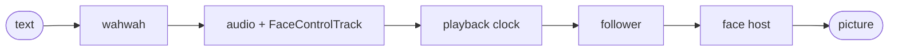

# Architecture

How the pieces fit together. For what this repository owns and what it does not, see [goals.md](goals.md).

## The flow

1. **wahwah** (the `wahwah` package) turns text into a rendered utterance: audio, plus a `FaceControlTrack` that says how the face should move over time. This repository does not make speech or timing.
2. **Playback** (`app/src/shared/playback.ts`) plays the audio and keeps one clock. The face reads the same clock, so the picture stays in step with the sound.
3. **The follower** (`app/src/shared/host/follower.ts`) holds the current face controls and returns them to neutral when speech stops.
4. **A face host** turns those controls into a picture. A host is anything that implements the `FaceHost` interface (`host/host.ts`). Today the one host is a VRM host, which drives any VRM avatar through its standard mouth expressions. Tofu, the built-in reference face, is a VRM too.
5. **The renderer** is one shared WebGL context, created by the playground page (`app/src/playground/main.ts`). Every host draws with it, then each playground cell copies its frame onto its own canvas, so many cells never run into the browser's limit on WebGL contexts.

## Inside the face host

`app/src/shared/host/` holds the host interface, the one host built on it, and the code that host uses. "Host" names a job, turning face controls into a picture, not a kind of code. So the folder mixes three kinds of file, and only one of them is animation.

**The host itself**

- `host.ts`: the `FaceHost` interface, and the `RenderStyle` type a model file can ask for.
- `vrm.ts`: the VRM host. It loads a model, places the lights and camera, and every frame sets the model's expressions from the current controls.
- `mappings.ts`: turns face controls into the VRM mouth expressions (the vowel shapes A, I, U, E, O). Unit tested.
- `faceNavigation.ts`: frames the camera on the face and keeps the user's orbit, pan and zoom when a cell is resized.

**Motion computed live (procedural animation).** See [procedural-animation.md](procedural-animation.md) for why.

- `follower.ts`: follows the control track and eases the face back to neutral when speech stops. It sits before the host in the flow: the playground runs one follower and hands its controls to every host.
- `mouthPlan.ts`: which replacement mouth to show, and when. Unit tested.
- `puppetMouth.ts`: the mouth modes for the Constraint Twist sample, both the cut-paper mouths and the shader patches.
- `referenceMouth.ts`: the traced mouth frames that Gesture replay draws.
- `studyMotion.ts`: Tofu's acting. Gaze, brow lift and body drive follow the phrasing of the speech, timed by settings stored in Tofu's file.
- Smaller pieces live in the files above: the blink timing (`Blinker` in `mappings.ts`, unit tested), and in `vrm.ts` Tofu's breath and the slow neck sway of every other model.

**Visual styles.** These change how a model is drawn, not how it moves.

- `surfaceStyle.ts`: patches a model's MToon materials for the painted-toon, ink-dither and comic-print looks.
- `inkDither.ts` and `comicPrint.ts`: the full-screen passes that draw a styled model through a small render target.
- `inkMethods.ts`: the table of dither methods, kept free of Three.js so a saved layout can be checked against it.

## Where code lives

- `app/src/shared/`: what any page can reuse, with no playground UI. Playback, face hosts, mouth and style code.
- `app/src/playground/`: the page that shows several models at once. Its grid layout, saved profiles and menus live here.
- `tools/`: scripts run by hand or at build time, such as the Tofu generator and the local model scanner.
- Models stay out of the repository, apart from Tofu. The playground lists the `.vrm` files it finds under `app/public/models/` when it starts.

## Design choices that run through the code

- **Motion is computed live, not stored in models.** See [procedural-animation.md](procedural-animation.md).
- **Logic that can be tested has no DOM or Three.js in it.** Layout rules, mouth timing and control mappings live in separate files for that reason, and the parts that need a GPU (shaders, drawing) are checked by running the playground.
- **A host does not know about the page.** The playground can show a new kind of face without changing playback or the follower, and a later OBS page can reuse `app/src/shared/` as it is.
